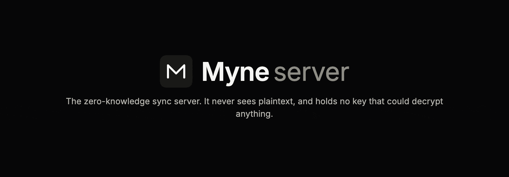

<p align="center"></p>

# Myne server

> You write. The server never reads. Hosted or self-hosted.

The zero-knowledge sync server for [Myne](https://github.com/myne-md/myne) — the open-source, end-to-end-encrypted, local-first markdown notes app. This repository holds the server that stores and relays encrypted note blobs between a user's devices. It never sees plaintext, never sees the master password or recovery phrase, and never holds a key that could decrypt anything. Every byte of note content is encrypted on the client before it leaves the device.

Myne is a multi-repo project under [github.com/myne-md](https://github.com/myne-md). The main repo carries the desktop client and the canonical specifications; the protocol this server must implement lives in [`myne/docs/spec/protocol.md`](https://github.com/myne-md/myne/blob/develop/docs/spec/protocol.md), and the threat model that bounds it lives in [`myne/docs/threat-model.md`](https://github.com/myne-md/myne/blob/develop/docs/threat-model.md). Read those before writing server code.

## Status

**Active, pre-alpha.** No longer a scaffold: the server runs, stores and relays the vault, and ships as a container image and a Helm chart. It is a Go program (`go 1.26`), one binary at `cmd/myne-server`, and it is the implementation behind the main repo's normative [`server-protocol.md`](https://github.com/myne-md/myne/blob/develop/docs/spec/server-protocol.md).

What exists today:

- `cmd/myne-server` — the server binary.
- `internal/` — the implementation, one package per concern: `httpapi` (routing, config, CORS, no-IP logging, metrics, health and readiness), `store` (the `mem` and `fs` backends), `accounts` / `auth` / `authapi` (account numbers, SCRAM, device approval), `syncapi` (blob push and pull, the vault head, cursors, retention and reclamation), `attachments` (the attachment half of the same surface), `awareness` (live-collaboration frames and their fan-out) and `poke` (the SSE poke channel), `b2bpersist` / `membership` / `grouppkg` / `profiles` / `relay` / `headid` (the B2B surface: invites, membership, group packages, per-person private profiles, the invite relay, signed-head author ids), `adminapi` / `panel` / `console` (the operator surfaces), `backup` (restic-backed backup and restore), `gcquota` (quota accounting and retirement reclamation), and `ids` / `authpersist`.
- `deploy/` — a Helm chart for the server and one for the web client, plus Kubernetes manifests.
- `Dockerfile` — a reproducible, minimal, non-root image. The shipped artefact is the image, and its digest is the verification unit (both bases pinned by `@sha256`).
- `LICENSE` (AGPL-3.0), `CLAUDE.md` (architectural notes and the non-negotiables below), `the CI configuration` (CI), `lefthook.yml` (the commit-hook baseline), and `KNOWN-GAPS-711.md` (the B2B surface's known gaps, recorded where they ship).
- `scripts/` — `repro-gate.sh`, the GitHub triage tooling, and the fetch tool.
- 97 Go test files; `go test ./...` is the suite.

The wire surface today: `/auth/*` (register, SCRAM init and final, verifier, device approve and revoke), `/sync/*` (blob push and pull, poke), `/attachments/*`, `/b2b/*` (invites, membership, retirement, profiles, group packages), and `/admin/*` behind `MYNE_ADMIN_SOCKET`. Route names and the wire contract are normative in the main repo's [`server-protocol.md`](https://github.com/myne-md/myne/blob/develop/docs/spec/server-protocol.md) and [`sync-protocol.md`](https://github.com/myne-md/myne/blob/develop/docs/spec/sync-protocol.md).

## How it works

The server is **outside the trust boundary by design** — it is trust boundary TB5 in the threat model, and the protocol assumes a curious or compelled operator. The client encrypts every note with XChaCha20-Poly1305 under keys derived via Argon2id + HKDF-SHA-256 from a master password the server never receives. The server's job is storage and conflict detection over ciphertext it cannot read.

This is why **hosted and self-hosted servers share the exact same trust boundary**. Self-hosting changes who runs the box, not the security model. What a hosted operator can see, a self-host operator can see, and vice versa: opaque blobs, hashed account identifiers, version counters, transient connection state, and aggregate quota counters — nothing more.

## Non-negotiable commitments

These are load-bearing for the zero-knowledge claim. Walking any of them back silently breaks it:

- **No plaintext, ever.** The server stores and relays ciphertext only.
- **No persistent server-side IP logging.** Abuse is mitigated with per-account counters, not per-IP records.
- **User-meaningful timestamps live inside the encrypted blob.** The server's per-note counter is opaque and is never exposed as if it were a real timestamp; there is no server-side last-write-wins.
- **No email at signup, no email recovery — ever.** This holds on the server as it does on the client.

Cross-implementation byte-level agreement is enforced by the [`myne-test-vectors`](https://github.com/myne-md/myne-test-vectors) companion: any server-side primitive must reproduce the same bytes as the Phase 1 Rust client, with no custom primitive implementations and hash-pinned dependencies.

See `CLAUDE.md` for the deferred design decisions and the gotchas that protect these commitments.

## Configuration

The server is configured entirely through `MYNE_*` environment variables. Read in
`internal/httpapi/config.go` (`loadConfig`), which fails fast on an invalid value so a
misconfigured server never starts in a surprising state.

| Group | Variables | Default |
|---|---|---|
| Storage | `MYNE_STORAGE_BACKEND` (`mem` or `fs`), `MYNE_STORAGE_PATH` | `mem` |
| Rate limit | `MYNE_RATELIMIT_BURST`, `MYNE_RATELIMIT_REFILL` | `256` / `16` per second |
| Quota | `MYNE_QUOTA_CEILING_BYTES` | `0` = unlimited |
| Retention | `MYNE_HORIZON_MARKERS`, `MYNE_EXTENDED_RETENTION` | `120` markers / `false` |
| Pre-auth bounds | `MYNE_PREAUTH_RATELIMIT_BURST`, `MYNE_PREAUTH_RATELIMIT_REFILL`, `MYNE_MAX_HANDSHAKES`, `MYNE_HANDSHAKE_TTL_SECONDS`, `MYNE_MAX_ATTACHMENTS_PER_VAULT` | `64` / `8` / `16384` / `60` s / `100000` |
| Account cap | `MYNE_MAX_ACCOUNTS`, `MYNE_MAX_DEVICES_PER_ACCOUNT` | `1000000` / `0` = unlimited |
| Web client | `MYNE_ALLOWED_ORIGINS` | `` = CORS off |
| Backup | `MYNE_BACKUP_ENABLED` plus `_REPOSITORY`, `_PASSWORD_FILE`, `_INTERVAL_SECONDS`, `_RETENTION_DAYS`, `_RCLONE_CONFIG`, `_RESTIC_BIN`, `_CACHE_DIR` | off; `86400` s, `14` days |
| Operator console | `MYNE_ADMIN_SOCKET` (CLI API), `MYNE_ADMIN_PANEL_ADDR` (read-only browser panel) | both disabled |
| Metrics | `MYNE_METRICS_ADDR` | `""` = disabled |
| Listener | `MYNE_SERVER_ADDR`, `MYNE_SERVER_PORTFILE` | `:8080` / unset |

Four of these need a sentence rather than a default:

- **`MYNE_PREAUTH_RATELIMIT_BURST` refuses `0`.** Every other ceiling in the table treats
  `0` as unlimited. Here it would reject every pre-auth request and lock out enrolment, so
  the server refuses to start instead of coming up unable to enrol anything.
- **`MYNE_ADMIN_PANEL_ADDR` has no authentication.** It is the one operator surface you can
  put on a network, and anything reaching it reads the account roster: hashes, stored bytes,
  device counts, freeze state. It shows no account numbers, because the server never receives
  them, and it logs nothing at all. A non-loopback address prints a warning and is not refused.
- **`MYNE_METRICS_ADDR`** is the ordinary exception to that: a non-loopback bind is usually
  correct, because Prometheus scraping from another host is the normal deployment.
- **`MYNE_EXTENDED_RETENTION`** keeps deleted ciphertext past the horizon, which weakens a
  user's expectation that deletion means gone.

**The `why` is not here.** What each knob obliges an operator to do, and what it costs, is
normative and lives in `docs/self-host-policy.md` in the `myne` repo (sections 3 and 4); this
file is the AGPL implementation and does not restate a CC-BY contract. The annotated,
per-knob copy an operator actually edits is `the operations repository/bundle/bundle.env.example`, and the two
are compared on every commit by `scripts/check-server-env-roster.mjs` in the `myne` repo, so
this table cannot drift from the server silently.

## Development

Run `go test ./...`. Packaging is the `Dockerfile` and `deploy/` (the server and web Helm charts); the other local tooling is the commit-hook baseline:

```bash
brew install lefthook && lefthook install   # one-time per clone; activates git hooks
```

The hooks run on commit: whitespace check, EOF-newline check, and a secret-pattern guard. Skip ad-hoc with `LEFTHOOK=0 git commit ...` or `git commit --no-verify` only when you understand why.

## License

AGPL-3.0 — see [`LICENSE`](LICENSE). This matches the application-code license of the wider Myne project; the specification documents in the main repo are published under a permissive content license so independent implementations can reuse the protocol.
