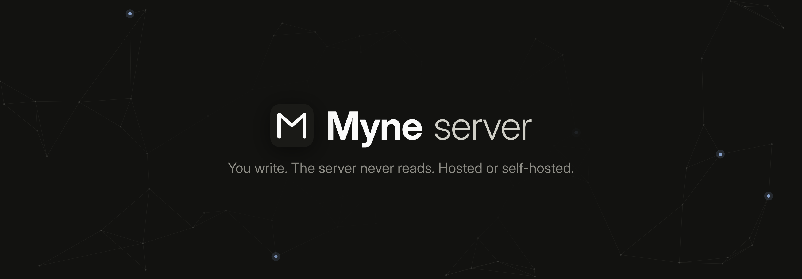

<p align="center"></p>

# Myne server

> You write. The server never reads. Hosted or self-hosted.

The zero-knowledge sync server for [Myne](https://github.com/myne-md/myne) — the open-source, end-to-end-encrypted, local-first markdown notes app. This repository will hold the server that stores and relays encrypted note blobs between a user's devices. It never sees plaintext, never sees the master password or recovery phrase, and never holds a key that could decrypt anything. Every byte of note content is encrypted on the client before it leaves the device.

Myne is a multi-repo project under [github.com/myne-md](https://github.com/myne-md). The main repo carries the desktop client and the canonical specifications; the protocol this server must implement lives in [`myne/docs/spec/protocol.md`](https://github.com/myne-md/myne/blob/main/docs/spec/protocol.md), and the threat model that bounds it lives in [`myne/docs/threat-model.md`](https://github.com/myne-md/myne/blob/main/docs/threat-model.md). Read those before writing server code.

## Status

**Pre-alpha — Phase 2, not yet started.** This repository is an empty scaffold. No application code has shipped.

What exists today:

- `LICENSE` — AGPL-3.0
- `CLAUDE.md` — architectural notes and the non-negotiable commitments below
- `lefthook.yml` — the baseline commit hooks (whitespace, EOF newline, secret-pattern guard)

What is planned, once Phase 2 opens:

- A **Go** sync server storing opaque ciphertext blobs keyed by hashed account identifiers
- Account-number authentication (verifier shape deferred to Phase 2; the main repo carries a v005 OPAQUE commitment but Phase 2 may decide otherwise — see `myne/design notes.md`)
- Per-note **opaque version counters** for conflict detection, resolved client-side after decryption
- A server-protocol spec (`myne/docs/spec/server-protocol.md`, does not exist yet)

Phase 1 is desktop-only with local vault storage and does not require a server. Work here stays parked until the Phase 1 pre-ship gate closes.

## How it works (intended design)

The server is **outside the trust boundary by design** — it is trust boundary TB5 in the threat model, and the protocol assumes a curious or compelled operator. The client encrypts every note with XChaCha20-Poly1305 under keys derived via Argon2id + HKDF-SHA-256 from a master password the server never receives. The server's job is storage and conflict detection over ciphertext it cannot read.

This is why **hosted and self-hosted servers share the exact same trust boundary**. Self-hosting changes who runs the box, not the security model. What a hosted operator can see, a self-host operator can see, and vice versa: opaque blobs, hashed account identifiers, version counters, transient connection state, and aggregate quota counters — nothing more.

## Non-negotiable commitments

These are load-bearing for the zero-knowledge claim. Walking any of them back silently breaks it:

- **No plaintext, ever.** The server stores and relays ciphertext only.
- **No persistent server-side IP logging.** Abuse is mitigated with per-account counters, not per-IP records.
- **User-meaningful timestamps live inside the encrypted blob.** The server's per-note counter is opaque and is never exposed as if it were a real timestamp; there is no server-side last-write-wins.
- **No email at signup, no email recovery — ever.** This holds on the server as it does on the client.

Cross-implementation byte-level agreement is enforced by the [`myne-test-vectors`](https://github.com/myne-md/myne-test-vectors) companion: any server-side primitive must reproduce the same bytes as the Phase 1 Rust client, with no custom primitive implementations and hash-pinned dependencies.

See `CLAUDE.md` for the deferred design decisions and the gotchas that protect these commitments.

## Development

The repo currently has no build or test commands — there is no application code yet. The only local tooling is the commit-hook baseline:

```bash
brew install lefthook && lefthook install   # one-time per clone; activates git hooks
```

The hooks run on commit: whitespace check, EOF-newline check, and a secret-pattern guard. Skip ad-hoc with `LEFTHOOK=0 git commit ...` or `git commit --no-verify` only when you understand why.

## License

AGPL-3.0 — see [`LICENSE`](LICENSE). This matches the application-code license of the wider Myne project; the specification documents in the main repo are published under a permissive content license so independent implementations can reuse the protocol.
